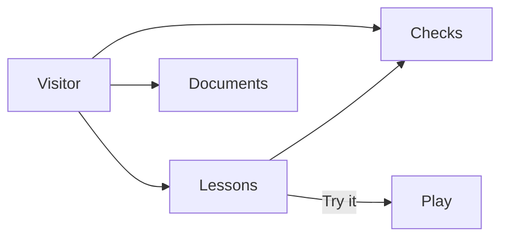
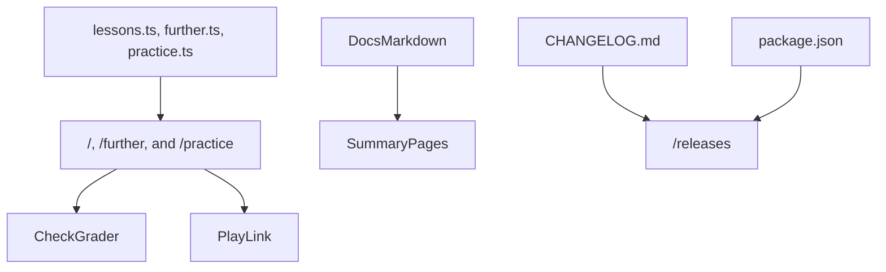
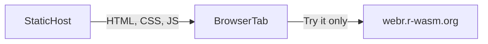

# Architecture and design

**Product:** Reticulum

**Last updated:** 2026-10-16

## Summary

Reticulum is a static Next.js site. The short path lives in `content/lessons.ts` and renders on `/`. The later lessons live in `content/further.ts` and render on `/further`. Practice lives in `content/practice.ts` and renders on `/practice`. The browser compares a chosen answer with the lesson's answer and shows the explanation. Try it opens `/play` with the program in the URL hash. `/play` downloads WebR, runs the snippet in the browser, shows stdout and stderr, and shows a plot when the program draws one.

`/language` is a reading page: origins, comparisons, reasons to choose the language, and where it is used. `/vision` and `/architecture` read the Summary section of the two documents at build time. `/releases` renders `CHANGELOG.md`. The header chip reads the version from `package.json`.

Hosting is a static export on GitHub Pages at https://reticulum.aathira-services.com/. That domain is the site root, so styles, scripts, pictures, and the icon load from `/`. https://jmaret.github.io/Reticulum/ redirects there. There is no database and no paid API. The pictures on the architecture page are the conceptual, logical, and physical views. The Mermaid diagrams later in this document are the same three views, and they change together.

## Conceptual

The visitor meets lessons, checks, and the living documents. A lesson can hand a program to `/play`. Checks are not sent anywhere.

Lessons are three pages. `/` holds thirteen programs, ordered from the top of a script through `NA`, `NULL`, and errors. `/further` holds eleven programs, from an S3 method through a missing value in a vector. `/practice` holds twelve programs: a package, a plot, and a summary. Checks are questions about those programs. Documents are the vision, the architecture, and the release notes. `/language` is a reading page beside them, written in the page itself rather than in those files. WebR runs a program only after the visitor chooses Try it.

## Logical

Lesson text, the documents, and the version are separate inputs. The three lesson pages are the ones that grade a check or build a `/play` link.

- `content/lessons.ts` holds the first page: the chapter, the explanation, the program, the notice, and the checks. `content/further.ts` and `content/practice.ts` hold the later lessons in the same shape. The answer id stays with the check. The page compares the chosen option with that id.
- `src/app/page.tsx` renders the short path. `src/app/further/page.tsx` renders the later lessons. `src/app/practice/page.tsx` renders packages, plots, and summaries. All three use the same lesson view, the same grader, and the same play link.
- `src/app/language/page.tsx` is the reading page on origins, comparisons, and use. It does not grade a check and it does not start R.
- `src/lib/docs.ts` reads a file at build time and returns the body of `## Summary`. The vision and architecture pages render that body. They do not keep a second copy.
- `src/lib/playground.ts` builds `/play/#code=` with the lesson program percent-encoded in the fragment. The code is not sent to a Reticulum server.
- `src/components/Playground.tsx` loads WebR 0.5.5 from `webr.r-wasm.org` with the `post-message` channel, so the page does not need cross-origin isolation headers. The result text is stdout and stderr. Conditions stay out of that text. A plot is shown beside it.
- `package.json` version is the header chip. `CHANGELOG.md` is the releases page.
- The three pictures on `/architecture` are SVG in `src/components/architecture/Diagrams.tsx`. They match these Mermaid diagrams.

## Physical

The host stores files. The browser grades checks. R runs in the browser, and only after Try it. The WebR files are downloaded from the WebR project at that moment.

- The export is static. GitHub Pages serves it at https://reticulum.aathira-services.com/, which is the site root, so styles, scripts, pictures, and the icon load from `/`. https://jmaret.github.io/Reticulum/ redirects to that domain. The export contains the pages, the fonts, the backdrop, and the icon. It does not contain an R interpreter.
- The browser downloads those files and grades checks in the tab. Answers are not sent to Reticulum and are not stored.
- `webr.r-wasm.org` sends the WebR runtime when the visitor opens `/play`. The program runs in the tab after that download. The public WebR editor was not used, because it does not document a URL that carries the lesson source.

## Visual system

The chrome matches AetherForge.

- Tokens in `src/app/globals.css`: ink `#152028`, muted `#5A6B76`, accent `#0F4C5C` / hover `#0C3D4A`, line `#D8C4AA`, paper `#F6EAD8`.
- Type: Source Serif 4, Source Sans 3, IBM Plex Mono, shipped as files under `src/app/fonts/` so a production build does not download them.
- Body: fixed `hero-bg.svg`. A petrol night sky holds stars and the Reticulum net, a sum and a line equation, an integral, a histogram under a normal curve, and a scatter with a fitted line. A light-brown wash (`#F6EAD8`) is stronger over the content column and lighter at the edges.
- Chrome: sticky header and footer use that light brown with a blur. Surfaces use `.panel`. Buttons are `.btn-accent` and `.btn-ghost`.
- The mark is a net of stars on a warm tan circle (`#E6CA98`), in the header and in `public/icon.svg`.
- The product name in the header is Reticulum, with no subtitle.

## Decisions

| Decision | Choice | Why |
| --- | --- | --- |
| Site | Next.js static export on GitHub Pages | Zero cost. The Pages workflow ships `out/` to https://reticulum.aathira-services.com/ at the site root |
| Checks | Graded in the browser | No account and no round trip |
| Interpreter | WebR on `/play` | The public editor does not document a link that carries source. WebR runs in the browser |
| Channel | `post-message` | A static host does not set the headers shared memory needs |
| WebR version | 0.5.5 | A pinned build, so Try it does not follow a moving latest URL |
| Lessons | Base R, including `graphics`, `stats`, and `datasets` | WebR does not have to download packages |
| Docs in the app | Summary section only | The page stays short. The file stays complete |
| Pictures | SVG on the page, Mermaid in this document | Both describe the same three views |
| Name | Reticulum | The product name is that word alone |
| Visual system | AetherForge tokens and type | One family with the other rooms |
| Backdrop | Stars, math, and statistics | The sky the lessons are set against |

## Changelog

- 2026-10-16 — First room: static export, lessons, in-browser checks, WebR on `/play`, three architecture views, and summary pages. The backdrop is stars, math, and statistics.
- 2026-10-16 — `/practice` joins the lesson pages. `/play` captures a base-graphics plot and shows it with the printed result.
- 2026-10-16 — GitHub Pages serves the site at https://jmaret.github.io/Reticulum/. The Pages build sets `BASE_PATH=/Reticulum`.
- 2026-10-16 — Try it prints stdout and stderr only. The icon uses the same `/Reticulum` prefix as the other assets.
- 2026-10-16 — The public site is https://reticulum.aathira-services.com/. Assets load from `/`, because that domain is the site root.
